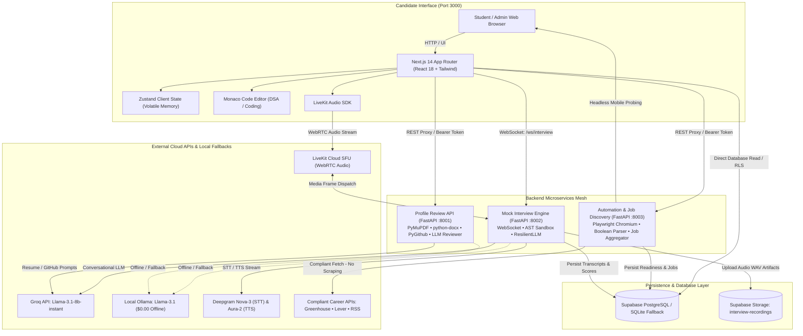

# Architecture & System Design Document

**Product Name:** Hireable (Autonomous Placement Readiness Copilot)  
**Target Specification:** Problem 2 — Placement Readiness Challenge: Student Proposal  
**Version:** 2.0.0 (Production Verified)  
**Audience:** MSOT Evaluation Panel, System Architects, Compliance Officers  

---

## 1. System Overview & Design Philosophy

**Hireable** is a production-verified Placement Readiness Copilot engineered to solve the technical readiness gap for collegiate engineering cohorts (specifically tailored for MSOT's 350-student class). In traditional placements, students receive delayed, opaque feedback only after actual interview rejections. 

Hireable unifies the placement lifecycle into a closed-loop system:
1. **Intake & Multi-Modal Audit**: Resume PDFs and DOCX documents, LinkedIn profiles, public GitHub repositories, and deployed live URLs.
2. **Deterministic Benchmark Engine**: Objective structural evaluations (1-page layout, action verbs, secret detection, mobile viewport rendering, static AST code checks).
3. **Adaptive Mock Interview**: 15–20 minute technical vivas grounded directly in candidate project architecture and target roles, featuring an interactive Monaco IDE coding round.
4. **Canonical Readiness Score**: Mathematical formulation across 7 official dimensions yielding a $S \in [0, 100]$ score and top 5 prioritized action items.
5. **Compliant Job Discovery & Tracking**: Aggregates verified positions using official Greenhouse/Lever APIs and RSS feeds without unauthorized scraping.

The architecture emphasizes **Dual-Mode Operation**: running either in cloud production (Groq, Deepgram, LiveKit, Supabase) or 100% locally at zero cost ($0.00) using local **Ollama** and local **SQLite**.

---

## 2. Four-Service Microservices Topology

Hireable is structured as four isolated microservices to segregate compute-heavy headless browser rendering and real-time audio streams from standard web transactions.



### Service Responsibilities & Ports

| Service Module | Source Path | Port | Core Technologies | Primary System Responsibility |
| :--- | :--- | :---: | :--- | :--- |
| **Frontend Core** | `frontend-core/` | `3000` | Next.js 14.2, React 18, TypeScript, Tailwind CSS, Zustand, Monaco Editor, `@dnd-kit/core` | Renders candidate onboarding, radar analytics, Monaco coding IDE, LiveKit audio panel, Kanban job tracker, and MSOT admin dashboard. |
| **Profile Review API** | `profile-review-api/` | `8001` | Python 3.12+, FastAPI, PyMuPDF, `python-docx`, PyGithub, LangChain, Groq/Ollama | Handles PDF/DOCX extraction, ATS rule evaluation, LinkedIn formatting, LeetCode profile analysis, and GitHub repository hygiene inspection. |
| **Mock Interview Engine**| `mock-interview/` | `8002` | Python 3.12+, FastAPI, WebSockets, LiveKit Agents, Deepgram STT/TTS, AST Sandbox | Drives adaptive 15–20 min technical vivas, coordinates WebRTC audio via LiveKit/Deepgram, and evaluates candidate coding submissions. |
| **Automation & Jobs** | `automation-and-job-discovery/` | `8003` | Python 3.12+, FastAPI, Playwright Headless Chromium, SQLite, Supabase Client | Runs mobile live-link audits, compiles Boolean search queries, aggregates Greenhouse/Lever/RSS jobs, and computes readiness scores. |

---

## 3. Legal Job-Sourcing & Compliance Framework

The competition specifications strictly mandate compliance with third-party platform terms:
> *"LinkedIn and many job sites prohibit scraping and automated applying in their terms, and accounts can be banned. Teams must prefer official APIs, RSS feeds, public career-page APIs (e.g. Greenhouse, Lever) and permitted sources, respect robots.txt and rate limits, and never use a student's login to scrape."*

### 3.1 Explicitly Enforced Forbidden Hosts
In `automation-and-job-discovery/src/job_discovery/aggregator.py`, the system explicitly hardcodes:
```python
ALLOWED_JOB_SOURCES = frozenset(
    {
        "greenhouse_ats",
        "lever_ats",
        "weworkremotely_rss",
        "jobicy_rss",
    }
)
FORBIDDEN_JOB_HOSTS = frozenset({"linkedin.com", "www.linkedin.com"})
```
- **Zero Unauthorized Scraping**: Hireable never makes unauthorized DOM scrapes against LinkedIn, Naukri, or Indeed.
- **Zero Student Credential Hijacking**: The system never prompts for or utilizes student user credentials to scrape private feeds.

### 3.2 Permitted Ingestion Pipelines
1. **Greenhouse Public Career API**: Queries official endpoints (`boards-api.greenhouse.io/v1/boards/{company}/jobs`).
2. **Lever Public Posting API**: Queries official endpoints (`api.lever.co/v0/postings/{company}`).
3. **Structured RSS Feeds**: Consumes syndicate feeds (Jobicy, We Work Remotely) with explicit `User-Agent` headers.
4. **Single-Flight Coordination & 15-Minute Cache TTL**: Prevents outbound rate-limit exhaustion through thread locks and stale-while-revalidate caching.
5. **Deduplication & Skill Matching**: Deduplicates listings by normalized `(company, title)` and calculates a 0–100 relevance score against student skills.
6. **One-Click Manual Apply**: Students click to open official job postings directly in new tabs; automated application submission ("auto-apply") is intentionally deferred to protect student accounts.

---

## 4. AST Sandbox & Code Execution Hardening

To evaluate student coding submissions without compromising host infrastructure:
1. **Static AST Analysis**: `mock-interview/tests/test_coding_evaluator.py` inspects the candidate's Python Abstract Syntax Tree prior to runtime.
2. **Forbidden Node Interception**: Calls to `exec`, `eval`, `__import__`, `open`, `compile`, or imports of `os`, `sys`, `subprocess`, `socket`, `shutil` are immediately rejected with syntax violations.
3. **Provisional Evaluation Contract**: Static evaluation results are explicitly tagged with `is_provisional: true` when container-isolated sandbox execution is unavailable.

---

## 5. Relational Persistence & Security Architecture

Hireable implements a relational schema on PostgreSQL (Supabase) with local SQLite fallback:
- **`profiles`**: Stores student metadata, target roles, scores jsonb, and freemium interview credits.
- **`interview_sessions`**: Persists conversation transcripts, timing metrics, and canonical `v0` scoring results.
- **`readiness_evaluations`**: Records historical 7-component score breakdowns and top 5 prioritized fixes.
- **`applications`**: Powers the 6-stage Kanban application tracker (`Saved`, `Applied`, `Shortlisted`, `Interview`, `Offer`, `Rejected`).
- **`msot_jobs`**: Allows campus placement faculty to post institution-exclusive drives directly to students.
- **Row-Level Security (RLS)**: Enforces that students can read and modify only records where `auth.uid() = student_id`.
- **Private Audio Storage**: Audio recordings are written to a private bucket (`interview-recordings`) accessible only via signed short-lived URLs.
