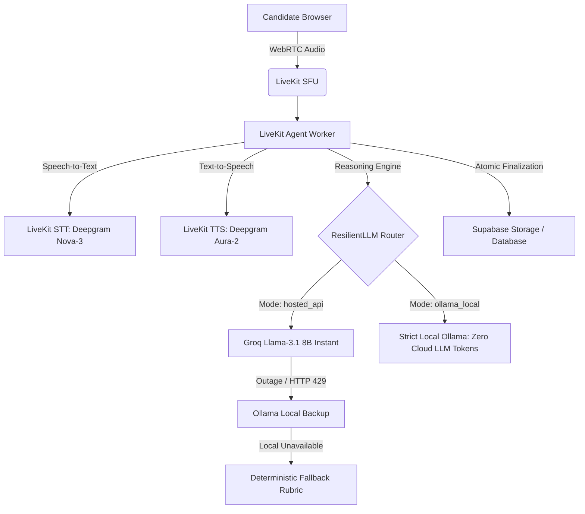

# Placement Readiness Copilot: Architecture, Capacity & Privacy Report

**Version**: 1.1.0 (Production Review Edition)  
**Date**: October 2026  
**Audience**: Engineering Leadership, System Architects, Compliance & Privacy Officers  

---

## 1. Executive Summary

The Placement Readiness Copilot platform provides an automated, dual-round technical interview and readiness assessment experience:
- **Round 1**: Real-time conversational interview grounded in candidate profile and verified resume context.
- **Round 2**: Interactive DSA and Web Development IDE challenges with static AST syntax/complexity analysis and container-isolated execution.
- **Placement Readiness Scoring**: Module 4 canonical 7-category composite scoring contract (Resume 25%, Projects 25%, Mock Interview 20%, GitHub 10%, Coding Practice 10%, LinkedIn 5%, Co-curricular 5%).

This document provides an honest, rigorous assessment of current measured benchmarks, provider failover mechanisms, sandbox isolation boundaries, and data privacy policies.

---

## 2. Capacity Benchmarks & Production Load Plan

### In-Process Concurrency Benchmark (`tests/test_concurrency_load.py`)
The automated test in `tests/test_concurrency_load.py` evaluates the **in-process async state machine and static AST analysis** across 50 concurrent simulated candidate flows:

| Dimension | Measured Benchmark | Scope & Limitations |
| :--- | :--- | :--- |
| **In-Process Concurrency** | 50 concurrent session objects | Evaluates async event loop, memory isolation, and AST parsing. |
| **State Machine Collisions** | 0 collisions / 0 race conditions | Verifies state machine locks, turn transitions, and finalizer idempotency. |
| **Completion Rate** | 100% (50/50 sessions completed) | In-process execution with simulated 5ms LLM completion latency. |
| **AST Analysis Throughput** | 50 AST evaluations in < 0.35s | Pure CPU static parse; does not execute untrusted code. |

> [!NOTE]
> **Production Scope Distinction**: This unit-level concurrency test validates internal state consistency under concurrency. It does **not** simulate distributed LiveKit SFU audio transcoding, WebSockets connection limits, network egress latency, or high-volume Supabase write contention.

### Planned End-to-End Load Testing Architecture
Before deploying to large-scale institutional cohorts (>250 concurrent candidates), the following architectural load plan is defined:
1. **LiveKit SFU Scale-Out**: Distribute audio streaming across autoscaled LiveKit media nodes managed by a Redis-backed room allocator.
2. **Dedicated Worker Fleet**: Run Python LiveKit agent workers in an autoscaling container cluster (1 worker pod per 5-10 concurrent voice sessions).
3. **Distributed Synthetic Load Tests**: Execute Locust/k6 synthetic test runners against the deployed WebRTC and FastAPI endpoints to measure real packet loss, audio jitter, and database pool saturation.

---

## 3. Provider Architecture, Local Mode & Fallback Transparency

### Provider Modes & Privacy Disclosures
1. **Hosted API Mode (`hosted_api`)**:
   - **LLM**: Groq Llama-3.1-8b-instant for sub-250ms conversational response times.
   - **Voice**: Deepgram Nova-3 (STT) and Aura-2 (TTS) via LiveKit Agents inference plugins.
   - **Failover**: Resilient failover to local Ollama if Groq returns 429 or 5xx errors; deterministic heuristic rubric if all LLMs are unreachable (flagged as `is_fallback: true`, `is_provisional: true`).
2. **Local Ollama Mode (`ollama_local`)**:
   - **LLM**: Local Ollama `llama-3.1` with `fallback=None`. **Zero outbound cloud tokens are transmitted for LLM scoring or reasoning.**
   - **Audio Disclosure**: Unless local Whisper STT and Piper TTS plugins are deployed in the self-hosted LiveKit pipeline, WebRTC audio streaming relies on the configured LiveKit cloud STT/TTS models. This dependency is explicitly disclosed to candidates and logged on worker startup.

---

## 4. Code Execution & AST Sandbox Hardening

To guarantee host safety on shared multi-tenant infrastructure:

1. **Default Mode: Safe Static AST Analysis**:
   - By default, `/api/interview/coding-evaluate` runs static Python `ast` syntax checks and keyword analysis without executing candidate code on the host.
   - Submissions evaluated in this mode are explicitly marked `is_provisional: true` and `test_execution_status: "sandbox_pending"`.
   - Provisional static scores are capped to prevent unverified solutions from receiving false 100% scores.
2. **Isolated Container Runner (`ENABLE_CONTAINER_SANDBOX=1`)**:
   - Host subprocess execution is restricted. Full dynamic unit test execution requires an external containerized sandbox (gVisor / Firecracker / Docker) with disabled networking and disposable file systems.
   - In development environments with `run_sandbox=True`, POSIX resource limits (`RLIMIT_CPU`, `RLIMIT_AS`, `RLIMIT_NOFILE`, `RLIMIT_FSIZE`) and a scrubbed environment without database secrets are enforced.
3. **Test Case Separation**:
   - `/api/interview/coding-problems` returns only public example cases (`example_cases`), keeping evaluator hidden test suites private to prevent evaluation gaming.

---

## 5. Security & Service-to-Service Protection

1. **Authentication Boundary**:
   - Background automation endpoints (`/api/link-check`, `/api/calculate-readiness`) and profile review endpoints (`/extract-pdf`, `/review/resume`, `/analyze-profile`) require trusted service-to-service Bearer tokens (`verify_service_token`).
   - Unauthenticated public clients cannot trigger headless Chromium browser runs or write arbitrary readiness records.
2. **Credential Sanitization in Browser Storage**:
   - LiveKit access tokens are kept **strictly in memory** in client state stores and are **never** persisted to `localStorage`.
   - Interview transcripts retained in browser storage are capped, and all interview state is purged upon session completion or logout.
3. **Live Link Checker Hardening**:
   - Headless Chromium runs with strict TLS certificate verification (`ignore_https_errors=False`).
   - Private, loopback, and link-local IP resolution (`127.0.0.1`, `169.254.169.254`, `metadata.google.internal`) is blocked before and during page navigation to prevent Server-Side Request Forgery (SSRF).
4. **Streaming Upload Protection**:
   - PDF upload endpoints enforce a 10 MB limit mid-stream using 64 KB chunk buffers, rejecting oversized payloads before loading entire files into memory.
   - PDF page limits (maximum 15 pages) prevent decompression bomb attacks.

---

## 6. Placement Readiness Scoring Contract

The canonical scoring engine implements the specification mandated in Problem Statement 2 (Page 12):

$$\text{Readiness Score} = 0.25 \times \text{Resume} + 0.25 \times \text{Projects} + 0.20 \times \text{Mock Interview} + 0.10 \times \text{GitHub} + 0.10 \times \text{Coding Practice} + 0.05 \times \text{LinkedIn} + 0.05 \times \text{Co-Curricular}$$

- **No Fabricated Evidence**: Only verified live links, test runs, and parsed components contribute to scores. Missing components default to 0 and trigger actionable recommendations.
- **Provisional Status**: If any component (such as an incomplete interview or static-only coding evaluation) is provisional, the entire composite report reflects `is_provisional: true`.

---

## 7. Data Privacy, Retention & Operational Observability

1. **Structured Diagnostics & Correlation IDs**:
   - All server errors generate a unique UUID `error_id` / `request_id` logged with server-side stack traces.
   - User-facing responses receive clean, sanitized error messages referencing the correlation ID without exposing internal database or provider infrastructure.
2. **Data Retention Policy**:
   - **Audio Recordings**: Candidate voice artifacts are stored in private Supabase Storage buckets governed by a 30-day automated lifecycle purge.
   - **Transcripts**: Stored for the duration of the placement preparation cycle (90 days) before automated pseudonymization.
   - **Ephemeral Token TTL**: LiveKit tokens are short-lived, with TTL dynamically matched to the configured session duration + 15 minute buffer (minimum 45 minutes).
