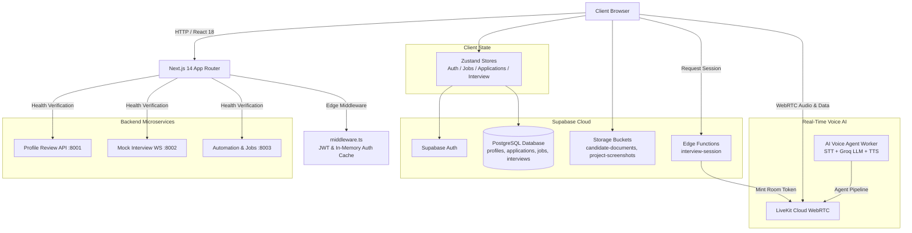

# MSOT Frontend Core

A full-stack, enterprise-grade AI placement readiness and mock interview platform built with **Next.js 14 (App Router)**, **TypeScript**, **Tailwind CSS**, **Supabase**, and **LiveKit WebRTC**.

---

## 🏗️ System Architecture



---

## 📁 Directory Structure

```text
frontend-core/
├── app/                                # Next.js 14 App Router routes
│   ├── (auth)/                         # Authentication route group
│   │   ├── signin/                     # Student & Admin sign-in page
│   │   ├── signup/                     # New student account registration
│   │   └── signout/                    # Automated sign-out handler
│   ├── (student)/                      # Protected student portal route group
│   │   ├── dashboard/                  # Overview, readiness score, recent interviews
│   │   ├── applications/               # Drag-and-drop Kanban application tracker
│   │   ├── jobs/                       # Curated & discovered job board
│   │   ├── resources/                  # PDF resume upload & professional links
│   │   └── interview/                  # Mock interview subsystem
│   │       ├── configure/              # Topic, role, difficulty, & company selector
│   │       ├── session/[id]/           # Real-time WebRTC audio interview room
│   │       ├── history/                # Historical interview attempts
│   │       └── results/[id]/           # Granular score breakdown & AI feedback
│   ├── admin/                          # Protected admin portal route group
│   │   └── dashboard/                  # Candidate oversight & job management
│   ├── api/                            # Serverless API routes
│   │   └── health/                     # Multi-service health probe (:8001, :8002, :8003)
│   ├── globals.css                     # Global design tokens & CSS variables
│   ├── layout.tsx                      # Root application layout & toast providers
│   └── page.tsx                        # Public landing page & product preview
│
├── components/                         # UI components
│   ├── ui/                             # Radix UI + shadcn/ui primitives (cards, dialogs, etc.)
│   ├── layout/                         # Structural layouts
│   │   ├── student-shell.tsx           # Collapsible stationary student sidebar
│   │   └── admin-shell.tsx             # Admin management navigation shell
│   ├── shared/                         # Reusable domain components
│   │   ├── page-header.tsx             # Standardized page headers
│   │   ├── empty-state.tsx             # Dynamic empty state illustrations
│   │   └── demo-banner.tsx             # Test environment indicator banner
│   ├── HoldButton.tsx                  # Long-press action button (used for Sign Out)
│   ├── auth-modal.tsx                  # Inline authentication dialog
│   └── onboarding-modal.tsx            # Initial candidate onboarding guide
│
├── hooks/                              # Custom React hooks
│   └── use-livekit-interview.ts        # WebRTC connection, room events, & mic management
│
├── stores/                             # Zustand client-side state stores
│   ├── auth-store.ts                   # Auth state, session persistence, role management
│   ├── application-store.ts            # Job applications synced to Supabase
│   ├── job-store.ts                    # Job listings synced to Supabase
│   ├── interview-store.ts              # Local interview session tracking & quotas
│   └── livekit-interview-store.ts      # Live transcript turns, questions, & scoring
│
├── lib/                                # Core libraries and utility functions
│   ├── supabase-client.ts              # Browser Supabase client (anon key)
│   ├── supabase-server.ts              # Server-side Supabase client (service role)
│   ├── livekit-session.ts              # Edge function caller for LiveKit token minting
│   ├── interview-result-adapter.ts     # Schema normalization for scoring payloads
│   ├── data-adapters.ts                # Database row normalizers for UI consumption
│   ├── auth-cookies.ts                 # HttpOnly / secure cookie sync helpers
│   └── utils.ts                        # Tailwind class merger (cn helper)
│
├── supabase/                           # Database & cloud functions
│   ├── migrations/                     # SQL schema migrations
│   │   ├── 20261010074113_create_profiles_table_with_roles.sql
│   │   ├── 20261011013738_create_interview_sessions_table.sql
│   │   └── 20261016000000_create_automation_tables.sql
│   └── functions/                      # Deno Edge Functions
│       └── interview-session/          # LiveKit room creation & JWT minting
│
├── types/                              # Shared TypeScript type definitions
│   ├── index.ts                        # Primary domain types (users, jobs, applications)
│   └── livekit.ts                      # LiveKit WebRTC event payload definitions
│
├── middleware.ts                       # Next.js Edge Middleware (RBAC + in-memory cache)
├── tailwind.config.ts                  # Tailwind theme and animation extensions
└── package.json                        # Dependencies and scripts
```

---

## 🌟 Key Application Features

### 1. Dashboard (`/dashboard`)
* Visualizes real-time placement readiness score (0–100) and readiness tier (*Placement Ready*, *Almost Ready*, *Not Ready*).
* Summarizes technical interview history, latest completed scores, and category breakdowns.
* Quick-action prompts for recommended preparation tasks.

### 2. AI Voice Mock Interview (`/interview/*`)
* **Configuration (`/interview/configure`)**: Customize target role (Software Engineer, AI/ML, DevOps), company type, difficulty level, and focus topics.
* **Live Room (`/interview/session/[id]`)**: Connects via WebRTC to LiveKit Cloud. Features live audio streaming, dynamic waveforms, real-time transcript streaming, and microphone controls.
* **Results (`/interview/results/[id]`)**: Comprehensive feedback report detailing overall readiness delta, technical/communication scores, strengths, and actionable fixes.

### 3. Application Tracker (`/applications`)
* Interactive Kanban pipeline tracking job stages: **Saved**, **Applied**, **Shortlisted**, **Interviewing**, **Offer**, and **Rejected**.
* Drag-and-drop workflow with direct database synchronization to Supabase `application_tracker`.

### 4. Job Discovery Board (`/jobs`)
* Searchable and filterable job postings aggregated from Greenhouse, Lever, and tech RSS feeds.
* One-click "Save to Tracker" dialog to immediately import opportunities into your Kanban board.

### 5. Resume & Professional Links (`/resources`)
* Direct PDF upload to Supabase private storage (`candidate-documents` bucket).
* Validated input fields for GitHub, LinkedIn, and LeetCode profiles.

---

## 🛡️ Routing & Security Architecture

### Edge Middleware (`middleware.ts`)
All route navigation passes through Next.js Edge Middleware:
1. **Protected Paths**: `/dashboard`, `/interview/*`, `/applications`, `/jobs`, `/resources` require valid student credentials.
2. **Admin Paths**: `/admin/*` enforces `role === 'admin'`.
3. **In-Memory JWT & Session Caching**: Decodes token signatures and caches verified user profiles in memory for 5 minutes. Eliminates redundant remote database round trips during client-side navigation for instantaneous tab transitions.

---

## ⚡ State Management & Database Mapping

Client state is decoupled into single-responsibility Zustand stores that interface directly with Supabase:

| Zustand Store | Supabase Table | Purpose |
| :--- | :--- | :--- |
| `useAuthStore` | `public.profiles` | Session authentication, profile metadata, student/admin roles |
| `useApplicationStore` | `public.application_tracker` | Kanban application tracking and status progression |
| `useJobStore` | `public.discovered_jobs` | Available job opportunities and search filtering |
| `useLiveKitInterviewStore` | `public.interview_sessions` | Real-time question turns, transcripts, and final score |

---

## 🛠️ Environment Configuration

Create a `.env.local` file in the `frontend-core/` directory:

```env
# -----------------------------------------------------------------------------
# SUPABASE (Client-side)
# -----------------------------------------------------------------------------
NEXT_PUBLIC_SUPABASE_URL=https://<your-project>.supabase.co
NEXT_PUBLIC_SUPABASE_ANON_KEY=your_anon_key

# -----------------------------------------------------------------------------
# SUPABASE (Server-side ONLY)
# -----------------------------------------------------------------------------
SUPABASE_SERVICE_ROLE_KEY=your_service_role_key
SUPABASE_JWT_SECRET=your_jwt_secret

# -----------------------------------------------------------------------------
# LIVEKIT WEBRTC
# -----------------------------------------------------------------------------
NEXT_PUBLIC_LIVEKIT_URL=wss://<your-project>.livekit.cloud
LIVEKIT_API_KEY=your_livekit_api_key
LIVEKIT_API_SECRET=your_livekit_api_secret

# -----------------------------------------------------------------------------
# BACKEND HEALTH PROBES (Optional)
# -----------------------------------------------------------------------------
PROFILE_REVIEW_API_URL=http://127.0.0.1:8001/health
MOCK_INTERVIEW_API_URL=http://127.0.0.1:8002/health
AUTOMATION_API_URL=http://127.0.0.1:8003/
```

---

## 🚀 Development Scripts

Run all commands from the `frontend-core/` directory:

```bash
# Install dependencies
pnpm install

# Start local Next.js development server (port 3000)
pnpm dev

# Type-check TypeScript code without emitting
pnpm typecheck

# Run ESLint validation
pnpm lint

# Build production bundle
pnpm build

# Start production server
pnpm start
```
